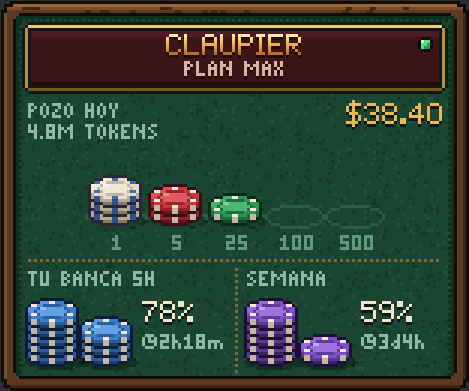
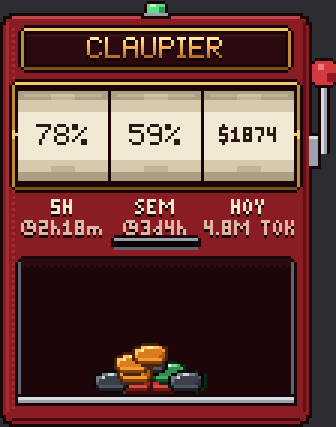
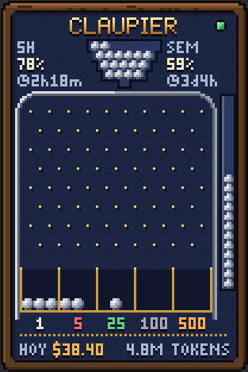
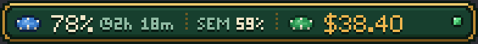

# Claupier

**El uso de Claude Code como una mesa de casino en pixel art.** Claupier es una ventana pequeña que se queda encima de tus juegos y apps. Muestra cuánto te queda de tu plan de Claude y cuánto costarían tus tokens con los precios de la API. Se muestra u oculta con un atajo, sin salir de lo que estés haciendo.

[Read in English](README.md)

<p>
  
  
  
</p>
<p>
  
</p>

La app está en **español e inglés**: sigue el idioma de Windows y se cambia en **Ajustes → Ventana → Idioma**.

> Claupier es un proyecto independiente y no oficial. No está afiliado a Anthropic, ni lo respalda ni lo patrocina Anthropic. «Claude» y «Claude Code» son marcas de Anthropic. El nombre es un juego de palabras entre Claude y *croupier*, el crupier del casino.

## Instalación

**Necesitas** Windows 10 u 11 (64 bits) y [Claude Code](https://claude.com/claude-code) instalado y con la sesión iniciada.

1. Descarga `Claupier_x.y.z_x64-setup.exe` de la [última versión](https://github.com/FredManBA/claupier/releases/latest).
2. Ejecútalo. Se instala solo para tu usuario y no pide permisos de administrador. Si falta WebView2 (raro en Windows 11), el instalador lo descarga.
3. El instalador no está firmado, así que Windows SmartScreen puede decir *«Windows protegió su PC»*. Pulsa **Más información → Ejecutar de todas formas**. Si prefieres, revisa el código y compílalo tú (ver [Compilar desde el código](#compilar-desde-el-código)).
4. Abre **Claupier** desde el menú Inicio. La mesa aparece en el centro de la pantalla (arrástrala adonde quieras o ánclala a una esquina en los ajustes) y aparece un icono en la bandeja del sistema.

Para desinstalarla: **Configuración → Aplicaciones → Aplicaciones instaladas → Claupier**. Tus ajustes quedan en `%APPDATA%\com.needyfriends.claupier\`; borra esa carpeta para quitarlos también.

## Cómo se usa

| Acción | Qué hace |
|---|---|
| `Ctrl+Alt+F` | Muestra u oculta la mesa sin quitarle el foco al juego |
| `Ctrl+Alt+G` | Modo fantasma: los clics atraviesan la mesa |
| Arrastrar | Mueve la mesa (si estaba anclada a una esquina, pasa a posición libre) |
| Doble clic | Actualiza el plan en ese momento |
| Clic derecho | Abre los ajustes |

El icono de la bandeja tiene las mismas opciones y **Salir**. Los atajos se cambian en **Ajustes → Atajos**.

### Qué significa cada texto

| Texto | Significado |
|---|---|
| **5H** / **TU BANCA 5H** | Tu ventana de uso de 5 horas: lo que te queda (o lo usado, si lo eliges) |
| **SEM** / **SEMANA** | Tu límite semanal |
| **HOY** | Hoy |
| **POZO** | Lo que gastaste en el periodo elegido |
| **◷ 2h 17m**, **◷ 3d 4h** | Lo que falta para que ese límite se reinicie (d = días, h = horas, m = minutos) |
| **4.8M TOKENS** / **TOK** | Tokens usados en el periodo |
| **ESPERA** | Anthropic pidió esperar (demasiadas consultas); Claupier vuelve a intentarlo solo |
| **SIN RED** | No hay conexión |
| **SIN SESIÓN**, **ABRE CLAUDE**, **CADUCÓ** | Claude Code no tiene la sesión iniciada o caducó: abre Claude Code para renovarla |

El piloto junto al nombre está gris mientras carga, verde cuando el plan está al día, naranja mientras espera y rojo cuando algo falla.

### Los cuatro diseños

Se eligen en **Ajustes → Diseño**, con vista previa animada.

| Diseño | Qué muestra |
|---|---|
| **Mesa** | Tu banca de 5 h en fichas azules y la semanal en fichas moradas, una ficha por cada 10 %; cuando baja la de 5 h, sus fichas se deslizan al pozo. En el pozo está tu gasto en fichas de casino, con el monto y los tokens al lado. Sonidos: fichas que caen y se deslizan |
| **Píldora** | Una sola fila compacta para dejar encima de un juego. Sonido: un toque mínimo |
| **Tragamonedas** | Tres rodillos: 5 horas, semana y dinero. El gasto cae por la ranura en monedas, un color por cada valor. Sonidos: palanca, rodillos y monedas (más graves cuanto más valen) |
| **Pachinko** | La tolva guarda lo que te queda de las 5 horas. Cada bola cae en la casilla de su valor. El tubo de la derecha es la semana. Sonidos: bolas en los clavos y al entrar en la casilla |

Valor de las fichas y las monedas: blanca $1, roja $5, verde $25, negra $100 y **naranja $500**.

### Ajustes

- **Ventana:** idioma (automático, español o inglés), seis tamaños de 1× a 4×, **texto pixel o normal** (el normal usa la letra de Windows para leer mejor; el logotipo sigue en pixel), opacidad, anclar a una esquina, siempre encima y nivel de animación.
- **Inicio:** arrancar con Windows, empezar oculta y empezar en modo fantasma.
- **Atajos:** cambiar los dos atajos.
- **Avisos:** notificaciones de Windows cuando la banca de 5 h o la semanal bajan de un porcentaje, cuando pasas un tope de gasto o cuando caduca la sesión. Cada aviso suena una sola vez por ventana o periodo.
- **Datos:** mostrar lo que queda o lo usado; el gasto de hoy, de la ventana de 5 h o de la semana; cada cuánto consultar el plan (mínimo 2 minutos); **dólares o cualquier otra moneda**, con su símbolo y el tipo de cambio que escribas.
- **Sonido:** sonidos suaves sintetizados para cada diseño, apagados por defecto, que se silencian solos mientras juegas en pantalla completa o con No molestar. **Escuchar el diseño elegido** toca una muestra.

## Cómo funciona

Claupier solo lee datos que ya están en tu computadora y hace una única consulta a Anthropic.

1. **Límites del plan.** Cada pocos minutos consulta a `api.anthropic.com` el uso de tu plan, el mismo dato que muestra el comando `/usage` de Claude Code. Usa el token de sesión que Claude Code guarda en `~/.claude/.credentials.json`. El token solo se envía a `api.anthropic.com` por HTTPS, sin seguir redirecciones, y nunca se registra, se guarda en otro sitio ni se muestra. Ese servicio no está documentado oficialmente y podría cambiar; si Anthropic responde «demasiadas consultas», Claupier espera cada vez más (hasta 15 minutos).
2. **Tokens y gasto.** Lee los registros locales de Claude Code (`~/.claude/projects/**/*.jsonl`) de los últimos 8 días, y cada vez solo las líneas nuevas. Respeta `CLAUDE_CONFIG_DIR` si lo usas.
3. **Gasto equivalente.** El dinero que ves es lo que costarían esos tokens con los [precios de la API de Anthropic](src-tauri/src/pricing.rs). Con un plan Pro o Max no se paga por token: sirve para ver cuánto usas, no es una factura. Las fichas, las bolas y las monedas siempre cuentan dólares, aunque el monto se muestre en otra moneda.

No hay telemetría, ni cuentas, ni ningún otro tráfico de red. Si usas Claude Code con una clave de API en vez de una suscripción, la parte del plan muestra **SIN SESIÓN**, pero los tokens y el gasto funcionan igual.

**Limitación conocida:** los juegos en pantalla completa *exclusiva* pueden tapar la mesa. En pantalla completa *sin bordes* se ve bien.

## Compilar desde el código

Necesitas [Node.js](https://nodejs.org) 24, [Rust](https://rustup.rs) con la cadena MSVC y WebView2.

```
git clone https://github.com/FredManBA/claupier.git
cd claupier
npm install
npm run tauri dev                       # la app con tus datos reales
npm run dev                             # en el navegador, con datos simulados
npm run tauri build                     # instalador en src-tauri/target/release/bundle/nsis/
cd src-tauri && cargo test              # pruebas de ajustes, avisos, precios y registros
```

En el navegador, `/` es la mesa, `/settings.html` son los ajustes y `/lab.html` muestra ampliados los sprites y las fuentes. Parámetros para probar: `?design=pildora|tragamonedas|pachinko`, `?still` (sin simulación), `?lang=es|en`, `?scale=1.5`, `?text=smooth`, `?currency=local&symbol=€&rate=0.92`, `?cost=1873.5`, `?used=93`, `?period=week`, `?bank=used`, `?ghost` y `?status=expired`.

Estructura:

- `src-tauri/src/`: ajustes, registros, plan, avisos, silencio en juego y precios (Rust).
- `src/core/`: fuentes pixel, fichas, monedas, bolas, materiales, pilas, formatos, sonido, puente con Tauri y vista.
- `src/designs/`: un archivo por diseño, todos con la misma interfaz (`design.ts`).
- `src/settings/`: la ventana de ajustes.

Los precios están en `src-tauri/src/pricing.rs`; hay que actualizarlos cuando salen modelos nuevos. Las contribuciones son bienvenidas.

## Licencia

[MIT](LICENSE). Las licencias de terceros están en [THIRD_PARTY_NOTICES.md](THIRD_PARTY_NOTICES.md).
