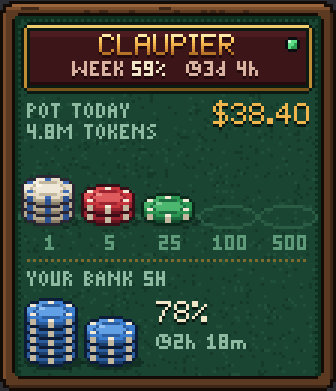
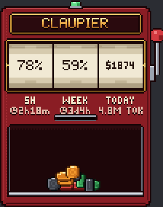
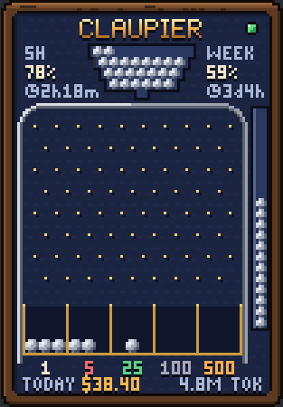

# Claupier

**Your Claude Code usage as a tiny pixel art casino table.** Claupier is a small window that stays on top of your games and apps and shows how much of your Claude plan you have left and how much your tokens would cost at API prices. Show or hide it with a hotkey, without leaving what you are doing.

[Leer en español](README.es.md)

<p>
  
  
  
</p>
<p>
  
</p>

> Claupier is an independent, unofficial project. It is not affiliated with, endorsed by or sponsored by Anthropic. "Claude" and "Claude Code" are trademarks of Anthropic. The name is a pun on Claude and *croupier*, the casino dealer.

The app speaks **English and Spanish**: it follows your Windows language, and you can change it in **Settings → Window → Language**.

## Install

**Requirements:** Windows 10 or 11 (64-bit) and [Claude Code](https://claude.com/claude-code) installed and signed in.

1. Download `Claupier_x.y.z_x64-setup.exe` from the [latest release](https://github.com/FredManBA/claupier/releases/latest).
2. Run it. It installs for your user only and does not need administrator rights. If WebView2 is missing (rare on Windows 11), the installer downloads it.
3. The installer is not code-signed, so Windows SmartScreen may say *"Windows protected your PC"*. Click **More info → Run anyway**. You can check the source and build it yourself (see [Build from source](#build-from-source)).
4. Open **Claupier** from the Start menu. The table appears in the middle of your screen (drag it wherever you like, or anchor it to a corner in the settings) and an icon appears in the system tray.

To uninstall it, go to **Settings → Apps → Installed apps → Claupier**. Your settings stay in `%APPDATA%\com.needyfriends.claupier\`; delete that folder to remove them too.

## How to use it

| Action | What it does |
|---|---|
| `Ctrl+Alt+F` | Show or hide the table without taking focus from your game |
| `Ctrl+Alt+G` | Ghost mode: clicks go through the table |
| Drag | Move the table (if it was anchored to a corner, it becomes free) |
| Double-click | Refresh the plan now |
| Right-click | Open the settings |

The tray icon has the same options, plus **Quit**. You can change the hotkeys in **Settings → Shortcuts**.

### What the labels mean

| Label | Meaning |
|---|---|
| **5H** / **YOUR BANK 5H** | Your 5-hour usage window: how much is left (or used, if you choose so) |
| **WEEK** / **WK** | Your weekly limit |
| **TODAY** | Today |
| **POT** | What you spent in the chosen period |
| **◷ 2h 17m**, **◷ 3d 4h** | Time until that limit resets (d = days, h = hours, m = minutes) |
| **4.8M TOKENS** / **TOK** | Tokens used in the period |
| **WAIT** | Anthropic asked to wait (too many requests); Claupier retries by itself |
| **OFFLINE** | No connection |
| **NOT SIGNED IN**, **SIGN IN**, **OPEN CLAUDE**, **EXPIRED** | Claude Code is not signed in or the session expired: open Claude Code to renew it |

The status light next to the name is grey while loading, green when the plan is up to date, orange while waiting and red when something is wrong.

### The four designs

Pick one in **Settings → Design**, with a live preview.

| Design | What it shows |
|---|---|
| **Table** | Your 5-hour bank as blue chips; when it drops, your chips slide into the pot. The pot holds your spend as casino chips, with the amount and tokens next to it. Sounds: chips landing and sliding |
| **Pill** | A single compact row to leave on top of a game. Sound: a tiny tap |
| **Slot machine** | Three reels: 5 hours, week and money. Your spend drops from the slot as coins, one color per value. Sounds: lever, reels and coins (deeper the more they are worth) |
| **Pachinko** | The hopper holds what is left of your 5 hours. Each ball lands in the pocket of its value. The tube on the right is the week. Sounds: balls on the pins and into the pockets |

Chip and coin values: white $1, red $5, green $25, black $100 and **orange $500**.

### Settings

- **Window:** language (automatic, English or Spanish), six sizes from 1× to 4×, **pixel or smooth text** (smooth uses the Windows font for easier reading; the logo stays pixel art), opacity, anchor to a corner, always on top and animation level.
- **Startup:** start with Windows, start hidden, start in ghost mode.
- **Shortcuts:** change both shortcuts.
- **Alerts:** Windows notifications when the 5-hour or weekly bank drops below a percentage, when you pass a spending cap or when the session expires. Each alert fires once per window or period.
- **Data:** show what is left or what is used; spending for today, the 5-hour window or the week; how often to check the plan (2 minutes minimum); **dollars or any other currency**, with its symbol and the exchange rate you type in.
- **Sound:** soft synthesized sounds for each design, off by default, muted automatically while you play in full screen or with Do Not Disturb on. **Play the chosen design** gives you a sample.

## How it works

Claupier only reads data that is already on your computer, plus one request to Anthropic.

1. **Plan limits.** Every few minutes it asks `api.anthropic.com` for your plan usage, the same data the `/usage` command shows in Claude Code. It uses the sign-in token that Claude Code stores in `~/.claude/.credentials.json`. The token is only ever sent to `api.anthropic.com` over HTTPS, without following redirects, and it is never logged, saved elsewhere or shown. This endpoint is not officially documented, so it may change; if Anthropic answers "too many requests", Claupier waits longer each time (up to 15 minutes).
2. **Tokens and spend.** It reads Claude Code's local logs (`~/.claude/projects/**/*.jsonl`) from the last 8 days, only the new lines each time. It respects `CLAUDE_CONFIG_DIR` if you set it.
3. **Equivalent cost.** The money shown is what those tokens would cost with [Anthropic's API prices](src-tauri/src/pricing.rs). On a Pro or Max plan you do not pay per token: it is a way to see how much you use, not a bill. Chips, balls and coins always count dollars, even if you show the amount in another currency.

There is no telemetry, no account and no other network traffic. If you use Claude Code with an API key instead of a subscription, the plan section shows **NOT SIGNED IN**, but the tokens and spend still work.

**Known limitation:** games in *exclusive* full screen can cover the table. In *borderless* full screen it shows fine.

## Build from source

You need [Node.js](https://nodejs.org) 24, [Rust](https://rustup.rs) with the MSVC toolchain, and WebView2.

```
git clone https://github.com/FredManBA/claupier.git
cd claupier
npm install
npm run tauri dev                       # the app with your real data
npm run dev                             # in the browser, with simulated data
npm run tauri build                     # installer in src-tauri/target/release/bundle/nsis/
cd src-tauri && cargo test              # tests for settings, alerts, prices and logs
```

In the browser, `/` is the table, `/settings.html` the settings and `/lab.html` a zoomed view of the sprites and fonts. URL parameters for testing: `?design=pildora|tragamonedas|pachinko`, `?still` (no simulation), `?lang=en|es`, `?scale=1.5`, `?text=smooth`, `?currency=local&symbol=€&rate=0.92`, `?cost=1873.5`, `?used=93`, `?period=week`, `?bank=used`, `?ghost` and `?status=expired`.

Project layout:

- `src-tauri/src/`: settings, logs, plan, alerts, quiet mode while gaming and prices (Rust).
- `src/core/`: pixel fonts, chips, coins, balls, materials, stacks, formats, sound, the bridge to Tauri and the view.
- `src/designs/`: one file per design, all with the same interface (`design.ts`).
- `src/settings/`: the settings window.

Prices live in `src-tauri/src/pricing.rs`; update them when new models come out. Pull requests are welcome.

## License

[MIT](LICENSE). Third-party licenses are listed in [THIRD_PARTY_NOTICES.md](THIRD_PARTY_NOTICES.md).
